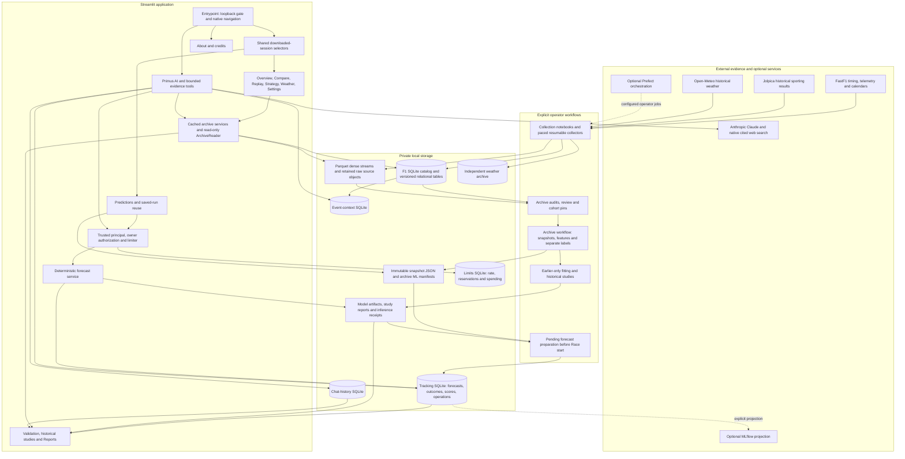
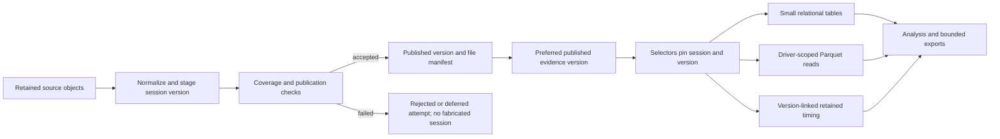
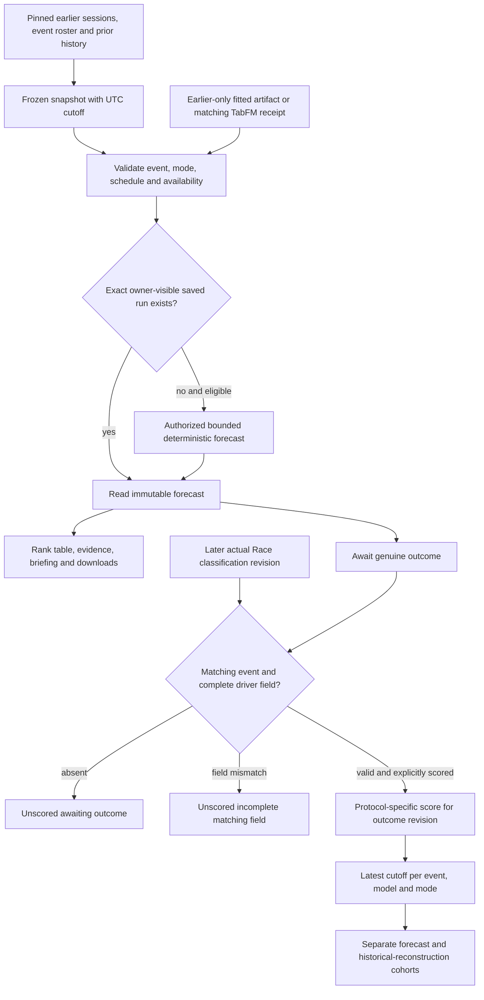
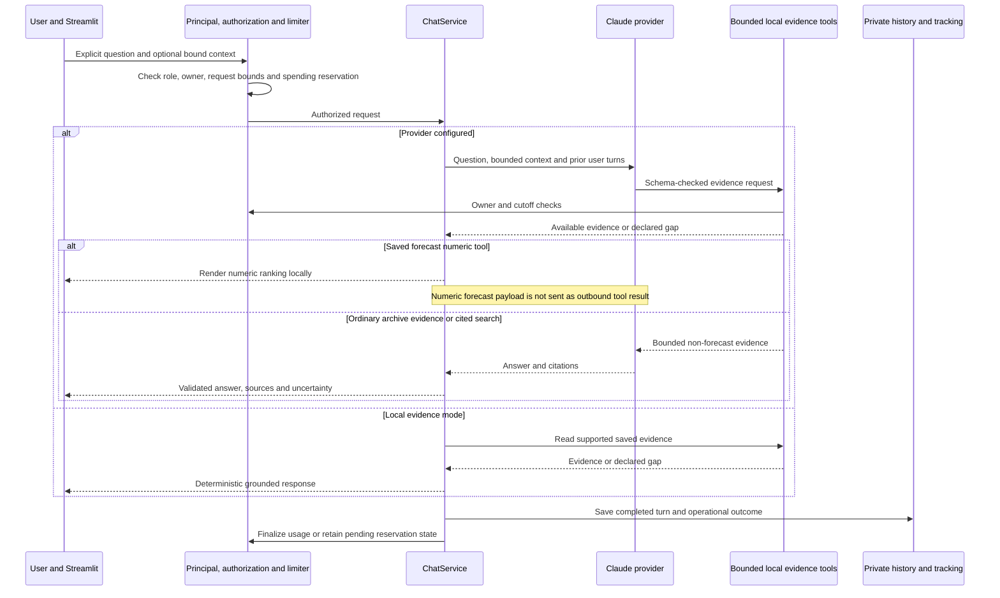

# Architecture and evidence flow

Primus F1 is a local Streamlit application over a versioned archive, cutoff-bound model inputs and owner-visible saved forecasts. Page rendering reads saved evidence; explicit user chat/forecast submissions use guarded services. Collection, model fitting, large-model inference preparation and historical studies are separate operator workflows. This describes implemented repository boundaries, not a deployed service.

## System map

Arrows identify functional dependencies, not an always-running pipeline. In particular, rendering the data library does not invoke collection, and viewing predictions does not schedule fitting. Optional integration settings or packages do not prove a reachable MLflow/Prefect server. The main archive UI reads its configured F1 root; independent weather is collected separately and must not be assumed to appear in every session plot.

## Ownership of code and state

| Concern | Implementation owner | State and contract |
|---|---|---|
| Navigation and global context | [app.py](../streamlit_app/app.py), [context.py](../streamlit_app/components/context.py), [screens.py](../streamlit_app/screens.py) | Shared selection persists across pages; dependent values reset on event/version changes. |
| Collection and publication | [collect.py](../data/archive/collect.py), [FastF1 extraction](../data/archive/fastf1_extract.py), [HTTP pacing](../data/archive/http.py), [store.py](../data/archive/store.py) | Single-worker lock, persistent checkpoints, retained originals, staged/published/rejected versions and per-channel coverage. |
| Archive reading | [reader.py](../data/archive/reader.py), [archive_services.py](../streamlit_app/archive_services.py) | Read-only SQL, bounded dense-file reads, preferred published version and selected-version checks. |
| Replay | [adapter](../data/archive/replay_adapter.py), [timing](../data/archive/timing.py), [replay](../data/replay.py), [UI](../streamlit_app/components/replay_ui.py) | Version-linked observations, shared native/browser clock semantics, freshness and fallback labels. |
| Modelling | [archive workflow](../ml/archive_workflow.py), [features](../ml/features.py), [training](../ml/training.py), [active study](../ml/active_study.py) | Frozen source pins; predictors separate from actual labels; preprocessing/fitting use earlier events. |
| Forecast submission | [jobs](../flows/jobs.py), [prediction service](../flows/prediction_service.py), [pending forecasts](../ml/pending_forecast.py) | Authorization/limits, exact event/mode/cutoff, artifact/receipt eligibility, immutable saved result reuse. |
| Assistant | [chat](../agents/chat.py), [Claude provider](../agents/claude_provider.py), [archive context](../agents/archive_context.py) | Bounded evidence tools; citations; local numeric forecast rendering; optional paid provider. |
| Identity and limits | [access](../security/access.py), [limits](../security/limits.py) | Server-established principal, owner/public/operator policy, role-gated actions and shared reservation ledger. |
| Results and reports | [tracking store](../monitoring/store.py), [queries](../monitoring/queries.py), [analysis export](../flows/analysis_report.py), [chat history](../agents/chat_history.py) | Forecasts/outcome revisions/scores separate; visible-owner reads; deterministic bounded exports; durable chats. |

### Storage layout

All paths below are project-relative defaults. These are local state, not files a public clone is guaranteed to contain.

| Location | Purpose |
|---|---|
| `.local/f1_2025_2026/f1.sqlite3` | Main UI archive catalog, session versions, entries/results/laps, events/status/messages, coverage and source/file manifests. The directory name does not limit the stored seasons. |
| `.local/f1_2025_2026/` raw and Parquet subtrees | Retained provider payloads and dense car/position data referenced by the catalog. |
| `.local/event_context/context.sqlite3` | Normalized sporting outcomes and independently sourced event context. |
| `.local/snapshots/` | Frozen input snapshots with source availability, entries, schedule and mode. |
| `.local/archive_ml/` | Cohort/feature/label references, active-study pointer and prepared pending comparison metadata. |
| `.local/models/`, `.local/model_studies/`, `.local/foundation_models/` | Fitted model artifacts, historical research, checkpoint assets and completed inference receipts. |
| `.local/tracking.sqlite3` | Immutable forecasts, genuine outcome revisions, scores and operational events. |
| `.local/limits.sqlite3` | Shared request, reservation and spending controls. |
| `.local/chat_history.sqlite3` | Owner-visible durable conversation turns and export metadata. |
| `data/reports/` | Preserved legacy narrative previews, explicitly unvalidated. |

The independent weather archive has its own configured root and SQLite/Parquet/raw provenance; see [collection](data-collection-2020-2026.md). Historical research manifests may retain internal absolute references. Public documentation uses relative paths and does not publish private identifiers, local file digests or raw workspace dumps.

## Publication and UI read flow

Collectors retain source objects, normalize tables, record quality/coverage and publish a version. A failed attempt is not automatically a valid empty publication. `ArchiveReader` opens SQLite in read-only/query-only mode and selects a published version using observed lap-evidence preference, lap count and publication insertion order. “Preferred published version” therefore does not simply mean newest timestamp.

Selectors enumerate these published sessions. Inventory cache keys include database mtime/size; table/dense caches include session/version and driver selection. If the selected publication changes, services require refresh rather than blending versions. Retained timing also receives a version pin. Parser-generated data is identified and excluded where chart/replay contracts require observed samples. Missing channels stay missing.

## Cutoff, forecasting and outcomes

`PredictionRequest` must agree with its immutable `DataSnapshot` event/mode/cutoff and schedule. Pre-race records must be eligible at that cutoff. Target Race labels are stored separately; earlier driver/team/circuit history must predate the target. Learned artifacts cannot contain target-event training rows and must meet earlier-training-time constraints. TabFM uses a validated matching inference receipt rather than generating a made-up substitute result.

Historical reconstruction deliberately labels original publication timing unverified and assumes retrospective session completion for research availability. It must not be presented as a contemporaneously saved forecast. Pending prospective preparation has stricter guards: preparation is before Race start; source retrieval and allowed earlier-session availability precede cutoff; target labels are removed. Existing prepared runs can be read after the race date without claiming a new pre-race freeze occurred then.

Saved forecasts, outcomes and scores are separate immutable records. A new outcome revision does not rewrite the forecast; old-revision scores do not become current automatically. Missing outcomes are not zero errors. The 2026 research holdout stays locked: the historical archive projection rejects automatic scoring for 2026. A future genuine forecast-performance workflow needs explicit outcome ingestion/scoring, not benchmark contamination.

## Identity and provider boundary

The Streamlit entrypoint rejects non-loopback bindings. `local_identity()` obtains the principal from trusted local server configuration, not browser claims. Generic OIDC verification helpers exist in `security/access.py`, but the default UI does not implement a hosted verified-login deployment. Roles distinguish read-only visibility, AI/forecast actions and operator operations. Private tracking/chat records retain owner policy; public records and operator access follow explicit authorization rules.

The provider's allowed tools do not expose arbitrary SQL, shell, files or user-supplied transport. Forecast numeric tools terminate at a local renderer. Ordinary bounded archive evidence can be sent to the provider to support a response. Prior assistant text is replaced by an omission marker in follow-up outbound history. Thus “local numeric forecasts” does not mean all chat processing is offline. Without configured credentials, provider generation/search is unavailable, while supported saved-evidence queries still work.

## Two worked system traces

**Completed 2020 Spain / 2025 United States.** Spain Race can flow from published archive version to overview, dense telemetry, retained timing replay and analysis ZIP. A United States 2025 study takes pinned earlier-weekend predictors, separately joined completed Race labels and earlier-trained models into a historical research report. Owner-visible saved reconstructions can be scored against genuine matching archived labels; publication timing remains explicitly unverified. Neither flow proves a live forecast existed before the historical event.

**Mexico 2026, race dated 1 November.** FP1, FP2, FP3 and Q are published in the documented local state; the R collection attempt failed. Those four sessions support analysis and replay of themselves. An already prepared pre-race snapshot supports eight model rankings over 22 drivers. They remain unscored. No R publication means no local actual Race classification or Race replay. The missing result does not become Q order, a model first pick, cancellation or zero error. A later update must publish actual evidence and explicitly handle outcome revision/scoring while preserving frozen forecasts and the separate locked research holdout.

Continue with the [walkthrough](project-walkthrough.md), [feature index](README.md), [archive reference](data-archive.md), [model workflow](archive-model-workflow.md), [provider design](primus-provider.md) and [new-race plan](new-race-update-plan.md).
